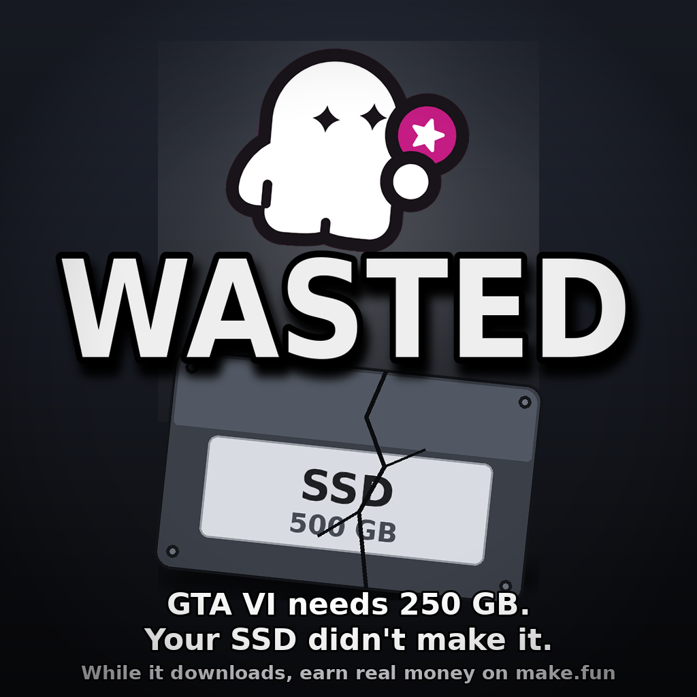

[](https://make.fun/bounty/gta6-meme-x-01?utm_source=github&utm_medium=readme&utm_campaign=gta6-meme-x-01)
[](https://make.fun/bounty/gta6-meme-x-01/leaderboard?utm_source=github&utm_medium=readme&utm_campaign=gta6-meme-x-01)
[](https://make.fun/bounty/gta6-meme-x-01/leaderboard?utm_source=github&utm_medium=readme&utm_campaign=gta6-meme-x-01)

# WASTED — GTA VI ate my SSD

A GTA 6 meme for make.fun's gta6-meme-x-01 bounty: GTA VI needs 250 GB, and
your SSD didn't make it. The make.fun ghost is the dead drive's soul rising
from the body, still clutching its coin, under the classic GTA "WASTED"
banner.



## The post

`POST.json` names the X post carrying this meme. The post's text carries the
bounty link, the play code, and the pitch: while GTA VI downloads, people and
their AI agents can earn real money on make.fun.

## Run it

Node 22+, standard library only. Copies `POST.json` to the output directory
(default `/output`):

```sh
MAKEFUN_OUTPUT_DIR=out node main.ts
```

## Files

- `meme.png` — the meme, 1024x1024
- `main.ts` — copies `POST.json` to `$MAKEFUN_OUTPUT_DIR`
- `POST.json` — the X post's address
- `LICENSE` — MIT

Built for make.fun — sign up with referral code taaana65: https://make.fun/r/taaana65
